# LUMO 商城后端服务架构

8 个业务域 · 30 个服务 · 19 条调用流程 | 技术评审稿 v1.0 | 2026-10-22

本文保留2026-10-22的原始目标设计与当时边界，以下“尚未实施”等描述是历史背景。当前实现已运行30个独立领域服务、专属RPC方法、Consul发现与独立Nginx前端；实际契约以 [API说明](api.md)、[独立RPC方法](rpc-methods.md) 和 [部署说明](docker-start.md) 为准，运行验收见 [最新部署记录](deployment-verification.md)。


本文依据现有前端范围设计：商品列表/详情、购物车、紧凑结算、支付结果、推荐、拼团、秒杀、满额换购、会员中心、地址、券积分、收藏足迹、评价问答、消息、发票、客服工单和退款换货。本文为架构评审稿，尚未实施后端。

## 1. 设计范围与默认业务口径

- 范围：当前综合商城的自营实物交易，支持多 SKU、多仓扩展；本版不引入多商户入驻、分账及储值钱包。
- 换购沿用前端含义：满额加价购；换货属于售后逆向履约，两条流程分开建模。
- 下述为目标后端设计。当前 Site 的浏览器本地模拟数据不能成为真实订单、库存、支付或会员资产凭据。
- 30 个服务是明确的数据与接口边界。独立部署目标不等于首期必须运行 30 套进程；部署分组见末页。
- 流量、日订单量、仓库/支付/短信/开票供应商尚未确定，因此不编造 QPS、机器规格及服务容量承诺。

## 2. 整体技术架构图

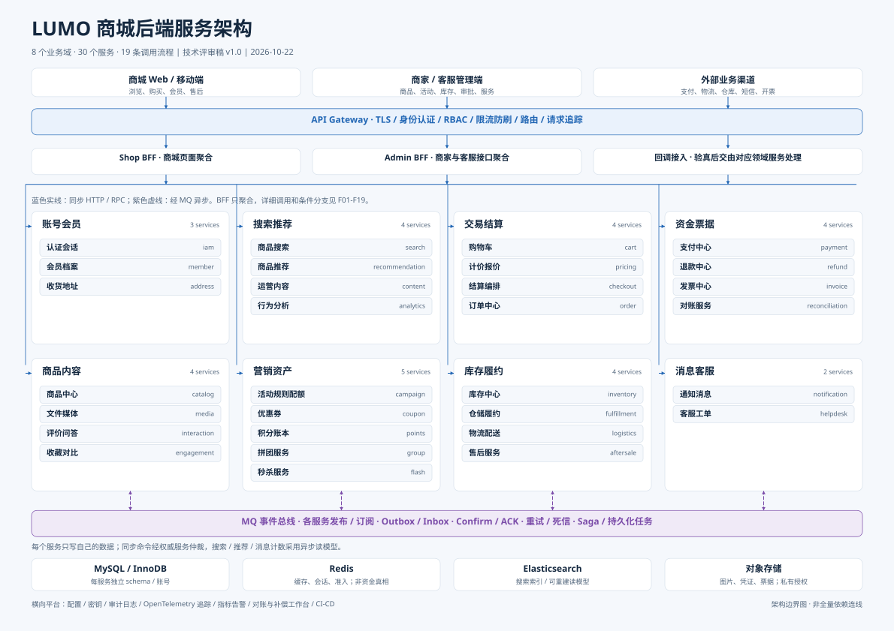

蓝色实线表示同步 HTTPS / RPC；紫色虚线表示异步领域事件。总图的接入线表示域路由，域间具体调用顺序按 F01-F19。外部渠道回调从网关专用路由进入权威服务，不经过页面聚合 BFF。

接入与分层约束：

- API Gateway：TLS、登录主体解析、会话状态检查、限流、防重放基础设施、服务路由；不计算价格、不裁决订单状态。
- Shop BFF / Admin BFF：面向商城页面和商家后台聚合接口，隔离返回字段与权限。BFF 不绕过服务直接访问数据库。
- 领域服务：自己维护状态、账本、本地事务与 Outbox；业务权限不能只依赖网关。
- 渠道适配器：支付、退款、物流、开票、短信接口分别封装在对应服务，保存请求与回执；不设一个可以任意改写所有业务表的“公共服务”。
- 平台能力：持久化任务调度、事件投递、审计、链路追踪、配置密钥、监控告警和补偿工作台是共享基础设施，不代替领域服务数据所有权。

## 3. 30 个服务的职责与数据所有权

| 业务域 | 服务名 | 职责 | 自有数据模型（示例） |
| --- | --- | --- | --- |
| 账号会员 | `iam-service` 认证会话 | 密码/验证码、令牌、设备会话、退出、RBAC | `identity / session / refresh_token / role` |
| 账号会员 | `member-service` 会员档案 | 资料、等级、成长值、偏好、账户状态 | `member_profile / growth_ledger` |
| 账号会员 | `address-service` 收货地址 | 地址簿、默认地址、归属与版本校验 | `address / default_address` |
| 商品内容 | `catalog-service` 商品中心 | SPU/SKU、规格、品牌、类目、售价、上下架 | `product / sku / category / price_version` |
| 商品内容 | `media-service` 文件媒体 | 上传授权、私有附件、对象引用、下载授权 | `file_meta / upload_grant` |
| 商品内容 | `interaction-service` 评价问答 | 已购评价、点赞、问答、审核与评分投影 | `review / helpful_vote / question / moderation` |
| 商品内容 | `engagement-service` 收藏对比 | 收藏、对比清单、最近浏览与搜索历史投影 | `favorite / compare_list / recent_view` |
| 搜索推荐 | `search-service` 商品搜索 | 关键词、品牌/库存过滤、排序、分页、建议词 | `product_index / terms / index_cursor` |
| 搜索推荐 | `recommendation-service` 商品推荐 | 相似/购买后推荐、召回排序、实验策略 | `recommendation / feature_snapshot / strategy` |
| 搜索推荐 | `content-service` 运营内容 | 首页楼层、横幅、专题、帮助文章与发布版本 | `page_slot / banner / article / publish_version` |
| 搜索推荐 | `analytics-service` 行为分析 | 曝光/点击/购买事件接入、去重、聚合特征 | `behavior_event / feature / aggregation_cursor` |
| 交易结算 | `cart-service` 购物车 | 商品行、规格数量、勾选、游客合并 | `cart / cart_item / merge_request` |
| 交易结算 | `pricing-service` 计价报价 | 计价、优惠叠加、运费、分摊、报价快照 | `quote / quote_line / discount_allocation` |
| 交易结算 | `checkout-service` 结算编排 | 确认页聚合、下单 Saga、资源提交/释放补偿 | `checkout_session / trade_saga / saga_step` |
| 交易结算 | `order-service` 订单中心 | 订单/明细快照、支付裁决、可履约状态 | `orders / order_item / state_log / payment_binding` |
| 营销资产 | `campaign-service` 活动规则配额 | 活动、换购、限购、配额预占及规则版本 | `campaign / rule / quota_hold / purchase_limit` |
| 营销资产 | `coupon-service` 优惠券 | 领券、券预占、核销、释放、退款返还 | `coupon_instance / coupon_hold / coupon_ledger` |
| 营销资产 | `points-service` 积分账本 | 签到、冻结抵扣、奖励、返还与冲回 | `points_account / points_hold / points_ledger` |
| 营销资产 | `group-service` 拼团服务 | 团、席位预占、有效付款人数、成团裁决 | `group_team / group_member / seat_hold` |
| 营销资产 | `flash-service` 秒杀服务 | 场次、准入、排队、请求去重、结果查询 | `flash_session / admission / purchase_request` |
| 库存履约 | `inventory-service` 库存中心 | SKU/仓库存、预占、分配、出入库账 | `stock / reservation / allocation / stock_ledger` |
| 库存履约 | `fulfillment-service` 仓储履约 | 出库、取消拦截、退货质检、换货补发 | `fulfillment / warehouse_task / return_inspection` |
| 库存履约 | `logistics-service` 物流配送 | 运费模板、可配送性、运单、正逆向轨迹 | `delivery_rule / waybill / tracking_event` |
| 库存履约 | `aftersale-service` 售后服务 | 申请/审核、数量占用、退回、退款/换货编排 | `aftersale / aftersale_line / eligibility_hold` |
| 资金票据 | `payment-service` 支付中心 | 支付单、渠道尝试、回调验真、主动查单 | `payment_order / payment_attempt / channel_receipt` |
| 资金票据 | `refund-service` 退款中心 | 额度占用、退款请求、结果确认、资金流水 | `refund_order / refund_attempt / refund_ledger` |
| 资金票据 | `invoice-service` 发票中心 | 抬头、额度、开票、文件、冲正/红冲关联 | `invoice_request / invoice / reversal / receipt` |
| 资金票据 | `reconciliation-service` 对账服务 | 支付/退款账单比对、差异、补单与人工处置 | `channel_bill / reconciliation_diff / repair_task` |
| 消息客服 | `notification-service` 通知消息 | 站内信、已读、短信邮件、模板、投递回执 | `inbox / read_state / delivery_task / template` |
| 消息客服 | `helpdesk-service` 客服工单 | FAQ 检索、规则助手、工单、会话、分派关闭 | `ticket / conversation / message / assignment` |

拆分规则：同一个数据库集群可以承载多个服务自己的 schema，但使用独立数据库账户和写入权限；禁止跨服务写表、依靠跨库 JOIN 实现交易或以共享“大用户表/大订单表”规避边界。分析服务可使用脱敏事件/离线副本。

以下子模块先放在同一数据边界中：IAM 的身份与会话；interaction 的评价/问答/审核；campaign 的规则、额度、限购和加价购；notification 的站内信与渠道投递；helpdesk 的工单与会话。后续按吞吐或团队边界再抽服务，不能把每个 CRUD 接口都拆成独立服务。

## 4. 调用流程阅读约定

1. `->>`：同步接口；`-->>`：经 Outbox / MQ 的异步事件。返回值若是普通同步返回，仍使用实线，并在文字写明返回。
2. 后续图省略固定接入层；图中的前端请求实际上经过 Gateway / BFF。只有渠道回调和指定内网命令使用专门路由。
3. 每图最多 5 个参与者；跨图衔接用 F 编号和图注标明，不把 15 个服务塞进一张时序图。
4. `alt/else` 是互斥分支；`opt` 是可选或后续场景。订单状态、资金状态、仓库状态、票据状态独立建模。
5. 部分只读查询可以并行，资源预占/确认/补偿按 Saga 进度协调，不假设分布式请求天然属于同一个事务。

### 流程索引

| 编号 | 流程 |
| --- | --- |
| F01 | 登录、退出与游客数据合并 |
| F02 | 商品列表、搜索与推荐 |
| F03 | 确认订单与配送信息 |
| F04 | 计价、优惠叠加与换购资格 |
| F05 | 提交订单与资源预占 Saga |
| F06 | 支付发起、回调与主动查单 |
| F07 | 接受支付、提交资产与放行履约 |
| F08 | 超时关单、支付竞态与资源释放 |
| F09 | 拼团：占席、付款、成团或失败 |
| F10 | 秒杀：准入、排队与真实下单 |
| F11 | 满额加价购与部分退款规则 |
| F12 | 出库、物流与确认收货 |
| F13 | 售后：申请、退回与质检 |
| F14 | 退款执行、回调与资金事实 |
| F15 | 开票、结果回调与退款后票据调整 |
| F16 | 个人中心、地址、领券和积分 |
| F17 | 评价问答、收藏对比和内容审核 |
| F18 | 消息中心、客服工单与回复 |
| F19 | 购买后推荐、行为事件与索引更新 |

### F01 登录、退出与游客数据合并

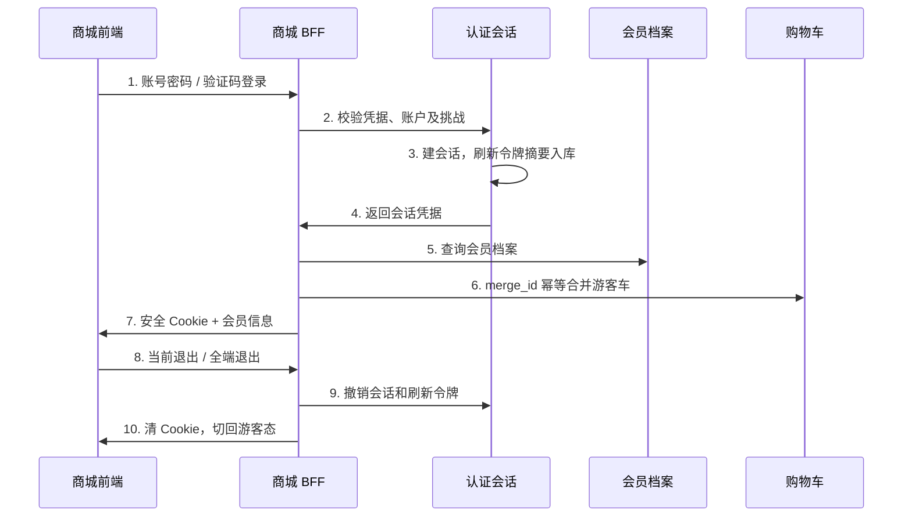

- 验证码通过 notification 的短信适配器发送；收藏、对比、搜索历史分别由 engagement 合并。
- 网关验证凭据；敏感写接口核对 session 状态。服务从登录主体取 user_id，并检查对象归属。
- 登录只允许合并游客购物数据，不能导入客户端券、积分、订单、发票；后台权限同属 IAM，业务审批仍由各服务校验。

### F02 商品列表、搜索与推荐

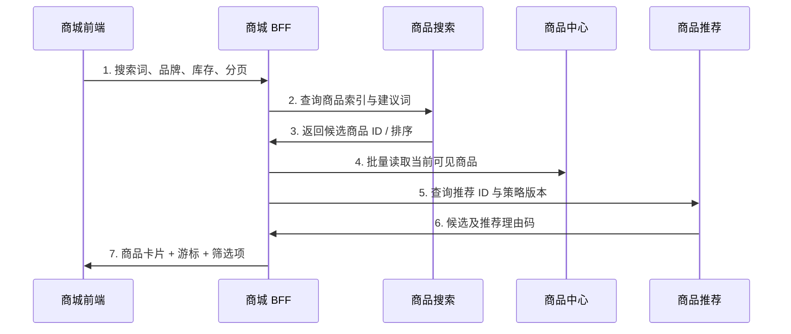

- BFF 另向 pricing / inventory 批量补齐展示价和可售标记；商品详情聚合 interaction 的公开评价/问答。
- catalog / inventory / campaign 的变更经 Outbox → MQ 更新索引；索引只是读模型，结算必须权威复核。
- 对比由 engagement 保存清单，BFF 聚合 catalog 规格、pricing 展示价和 inventory 状态；足迹异步写入。

### F03 确认订单与配送信息

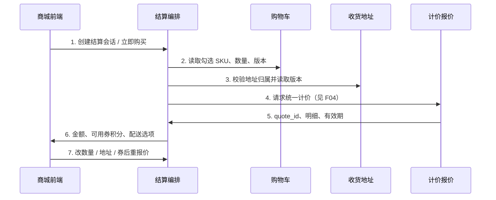

- 图中前端调用均实际经过网关和 BFF；为保持业务顺序清晰，后续流程图省略该固定接入层。
- Checkout 并行调用 catalog 校验 SKU、logistics 校验可配送性、inventory 查询余量；本阶段不预占资源。
- 前端提交选项和 quote_id；应付金额、运费、券积分抵扣均由后端生成。地址变更不修改历史订单快照。

### F04 计价、优惠叠加与换购资格

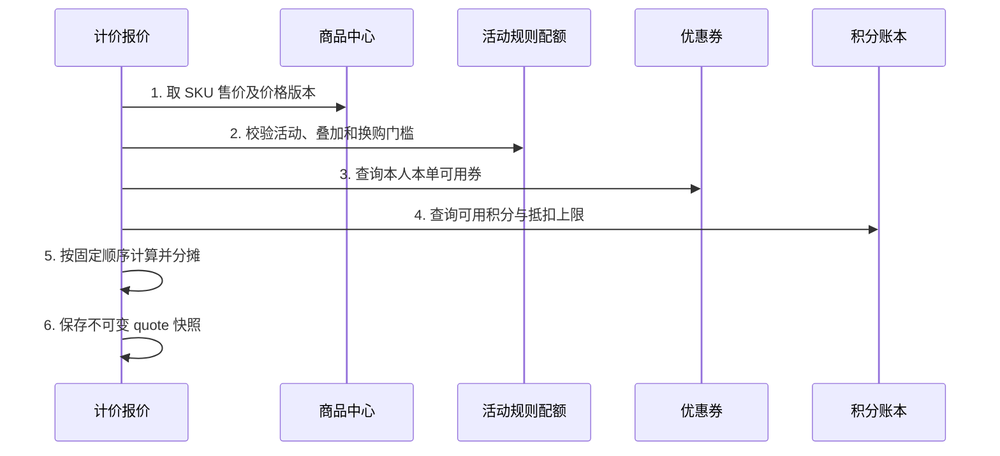

- pricing 同步调用 logistics 获取当前地址运费。金额使用整数分；分摊尾差和舍入规则固定且可复算。
- campaign 内部分为规则、额度/限购、满额换购三个模块；换购金额不反向凑门槛，规则/价格版本写入 quote。
- 报价只作有限时效承诺；提交时重新核验版本与资格。券和积分真正可用性由下单预占裁决。

### F05 提交订单与资源预占 Saga

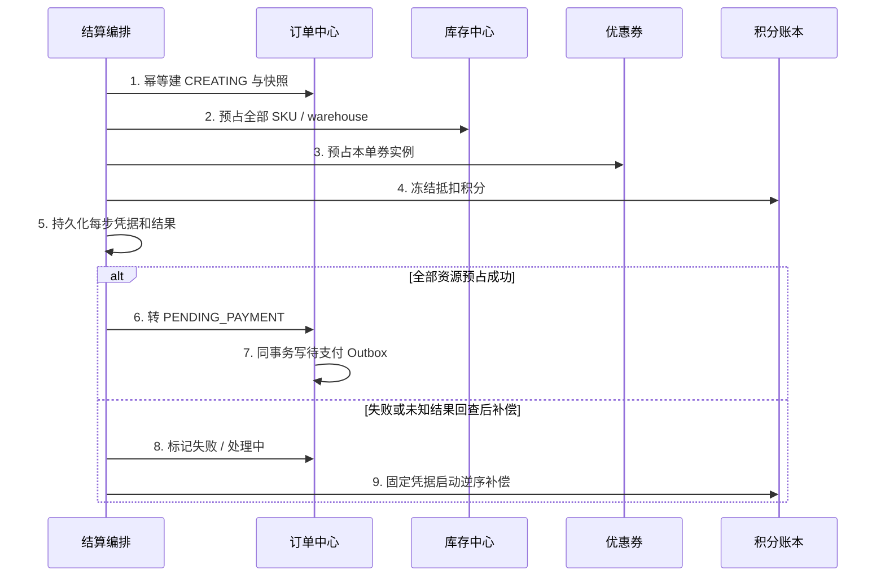

- 第 2 步后另调用 campaign 预占额度/限购，拼团另调用 group 预占席位；秒杀带 admission_id。全部凭据写入 Saga。
- 补偿顺序：积分 → 券 → 活动/席位 → 库存。超时是 UNKNOWN，按固定 reservation_id 回查或 Cancel；资源保留取消墓碑，拒绝迟到 Try。
- idempotency_key + user_id 唯一。HTTP 超时查询原 intent/order；CREATING 不能支付。最终订单保存地址、单价、优惠分摊及规则快照。

### F06 支付发起、回调与主动查单

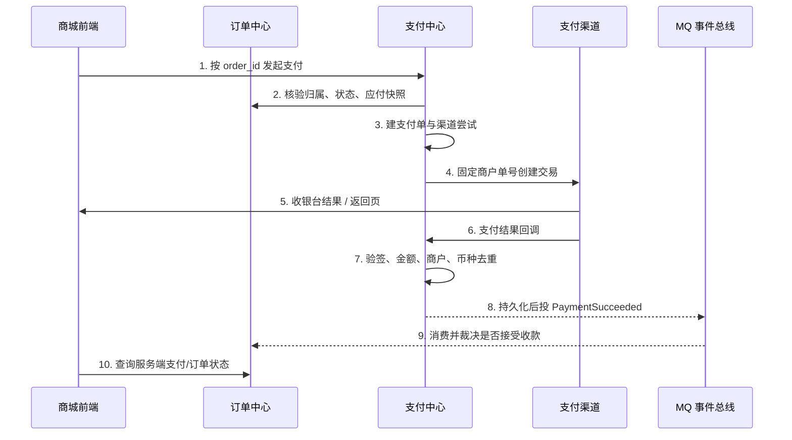

- 浏览器返回与前端按钮不能确认收款。回调原文/摘要及资金流水持久化，再及时应答渠道。状态未知时用原商户单号查单。
- payment 按 order_id 串行化创建尝试与冻结关单，持久化 gate/version；渠道创建超时也属待查尝试，冻结后拒绝新尝试。重复真实收款记账并退款。
- 只有订单接受支付并完成资源提交后才能履约，inventory 和 fulfillment 不直接消费 PaymentSucceeded 发货。

### F07 接受支付、提交资产与放行履约

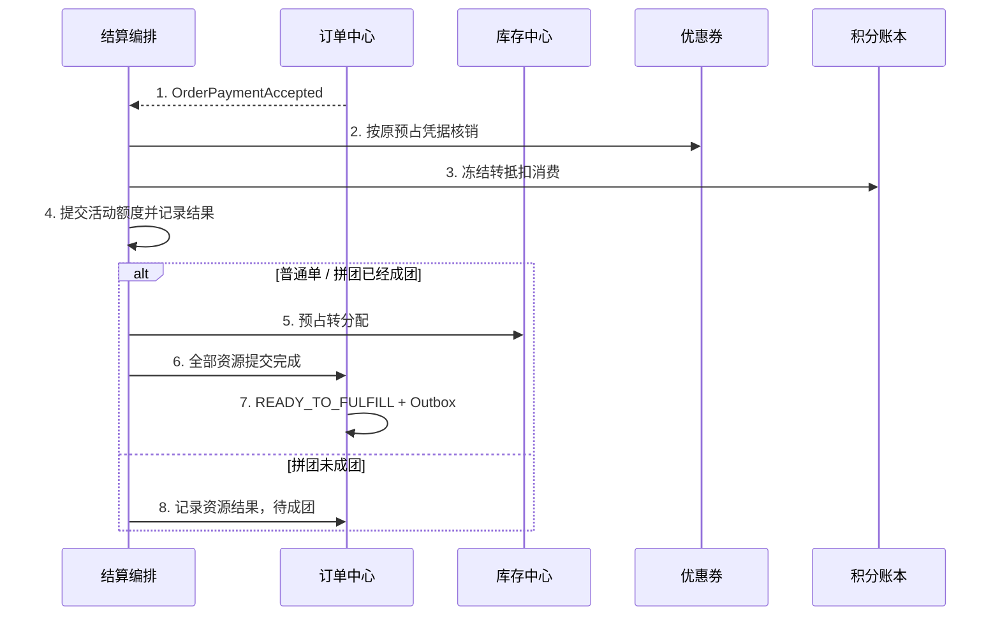

- F05 预占凭据支持 Confirm/Cancel 幂等。资源提交失败停留 PAID_CONFIRMING，重试或人工处置；不能在未就绪时发货。
- 拼团库存仍预占；order 记录成团和资产提交结果，二者同时满足且团未失败才分配并放行；GroupFormed 与资源提交事件先后不影响结果。
- 下单券积分在收款后提交；购买奖励积分在订单完成后入账。失败收款或已关闭订单由 checkout 调 refund 自动退款。

### F08 超时关单、支付竞态与资源释放

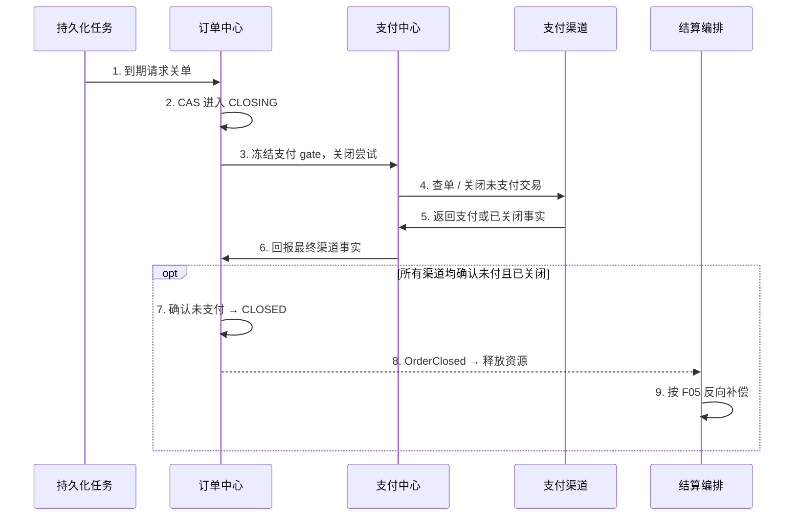

- 已支付按渠道 paid_at、截止政策和订单前态裁决：接受转 F07，拒收转退款；未知保持 CLOSING 重试。支付与关闭由同一订单版本 CAS 仲裁。
- 确认关闭后才释放预占；不能仅凭 Redis TTL 自动释放支付裁决中的库存、券、积分、配额、席位。
- 若订单已 CLOSED 后才确认真实收款：保存支付事实并自动退款，订单不复活。任务使用 due_at 持久化扫描，MQ 延时提示可辅助但不是唯一保障。

### F09 拼团：占席、付款、成团或失败

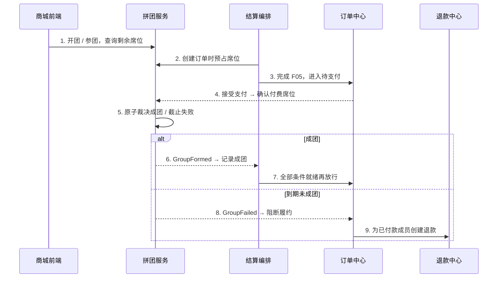

- 成团人数仅统计订单已接受的付款席位；用户刷新页面、示例人数和未付款席位不能计数。
- 最后一笔付款与截止任务竞争同一团版本；已失败团收到迟到收款，订单走退款，不允许重新成团。
- 失败后确认未出库且履约被终止，可释放库存；券积分在 RefundSucceeded 后按规则返还。资金和库存的完成时间分别展示。

### F10 秒杀：准入、排队与真实下单

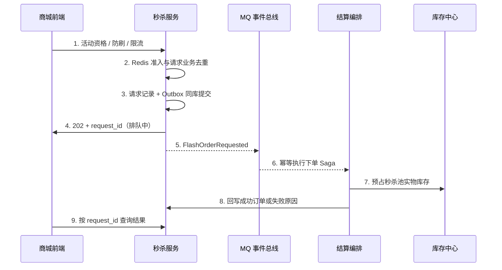

- campaign 负责活动配额和限购凭据；inventory 负责唯一实物账，活动库存池由其分配，不能与普通池重复售卖。
- Redis 只承担流量准入与缓存预扣；最终订单必须获得持久化库存/活动凭据。队列接收不等于订单创建成功。
- user_id + activity_id + sku_id + 购买资格槽唯一；失败关单释放未消费额度。支付后退款是否恢复限购资格由活动政策明确。

### F11 满额加价购与部分退款规则

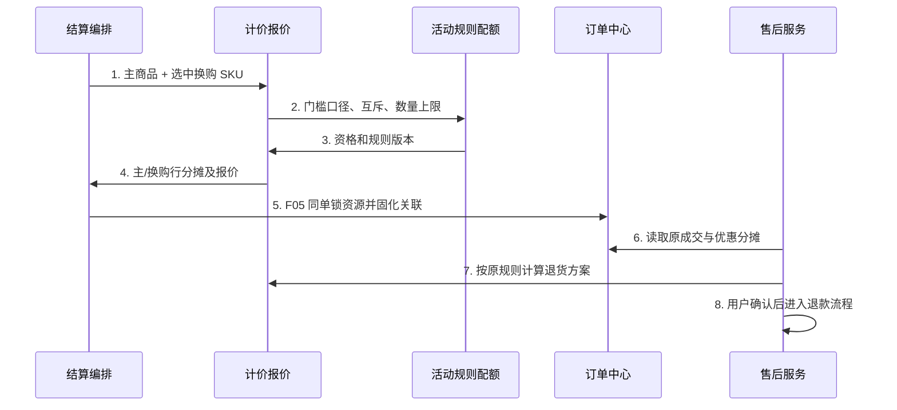

- 换购商品自身不能凑门槛；改主商品数量、规格、地址或券后重新报价，不能沿用旧资格。换购行也要独立锁库存。
- 退货破坏门槛时展示整组退回或保留换购项的明确调整方案；首期可采用整组退回策略，规则必须在购买前展示并保存版本。
- 所有退款使用原成交快照计算，累计现金实退不超过原实付。不能以当前商品价倒算，也不能静默追加扣款。

### F12 出库、物流与确认收货

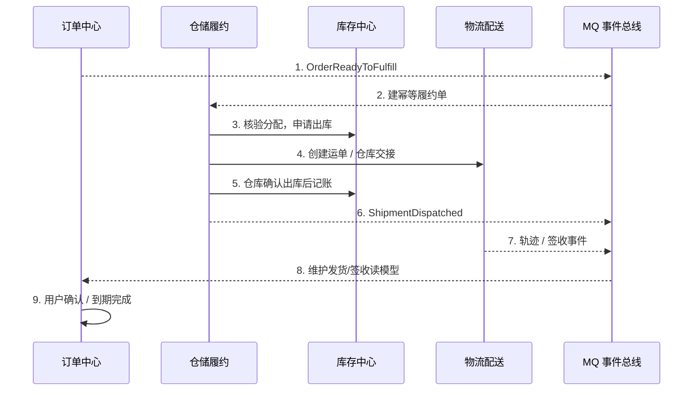

- 出库任务和仓库回执独立持久化；库存扣减以仓库实际出库确认计账，不以创建快递单成功代替。
- 取消/仅退款必须与履约拦截原子协调；已出库不能继续按未发货释放库存。承运商重复/乱序回调以运单事件键和时间处理。
- OrderCompleted 驱动 points 奖励、member 成长值、评价资格与推荐特征；签收和完成可有售后保护期，不强行混同。

### F13 售后：申请、退回与质检

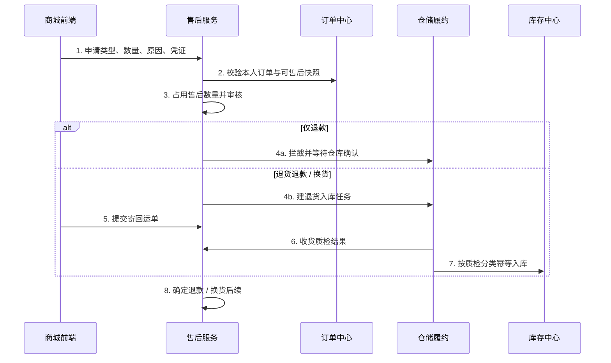

- 同一行申请中的售后占用数量，防止并发超量退款；退回运单由 logistics 跟踪，凭证由 media 私有保存。
- 仅退款不增加实物库存；未出库需 CANCEL_REQUESTED → WAREHOUSE_CANCEL_CONFIRMED 后才释放分配。退回按可售/残次/报损分类。
- 换货：验收旧品 → 预占新 SKU → 必要补差支付 → 新履约出库 → 新运单签收完成；无货等待/改选/转退款，不伪造换货成功。

### F14 退款执行、回调与资金事实

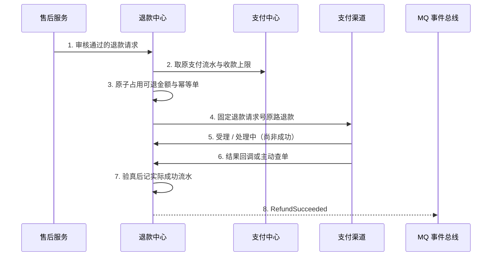

- refund 聚合原支付单的已成功 + 处理中的退款额度，防止跨售后并发超退；未知状态不释放额度、不换新请求号重试。
- 成功事件分别驱动 order/aftersale 更新资金状态、coupon 按政策退券、points 按分摊返还/冲回、invoice 启动票据调整。
- 券积分处理失败独立重试，不能撤销已经发生的渠道退款。部分退款按行分摊和累计上限控制，最后一笔吸收尾差；不足冲回积分记待抵扣账。

### F15 开票、结果回调与退款后票据调整

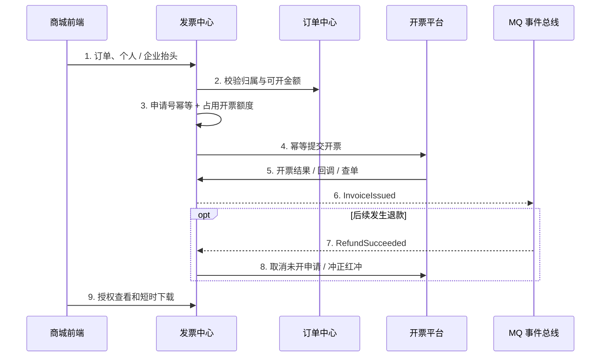

- 拼团待成团只保存开票意向，满足业务开票条件后提交。退款/开票并发通过额度、版本与渠道查单协调。
- 已开具票据不能简单删除或直接标为已失效；保留原票与关联调整记录。部分退款、冲正/红冲按正式开票平台能力和财务规则落地。
- 票据状态独立于退款资金状态，失败重试/人工处理；文件通过 media 的短时授权访问，禁止永久公开发票链接。

### F16 个人中心、地址、领券和积分

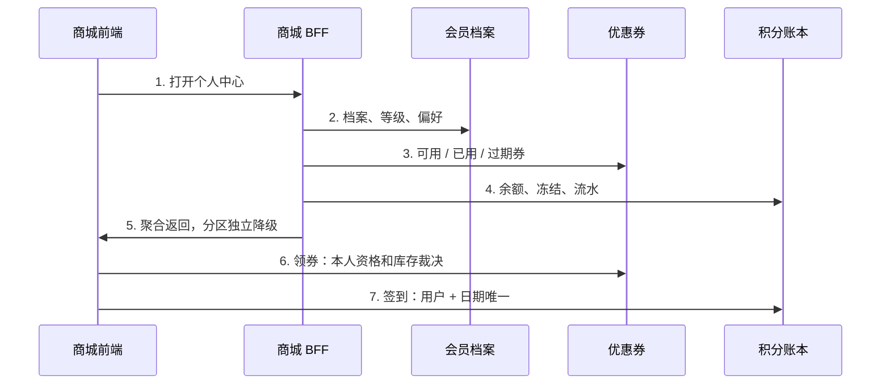

- BFF 并行查询 order 订单计数、notification 未读、aftersale 进度；详情列表用独立分页 API，避免一次拉取全部历史。
- 地址增删改直接调用 address；设置默认地址单事务保证最多一个默认项。订单地址改动走订单命令并协调履约。
- 积分使用不可变流水与冻结单。会员成长和奖励积分依赖 OrderCompleted；账户余额由积分服务维护，其他服务不能直接改表。

### F17 评价问答、收藏对比和内容审核

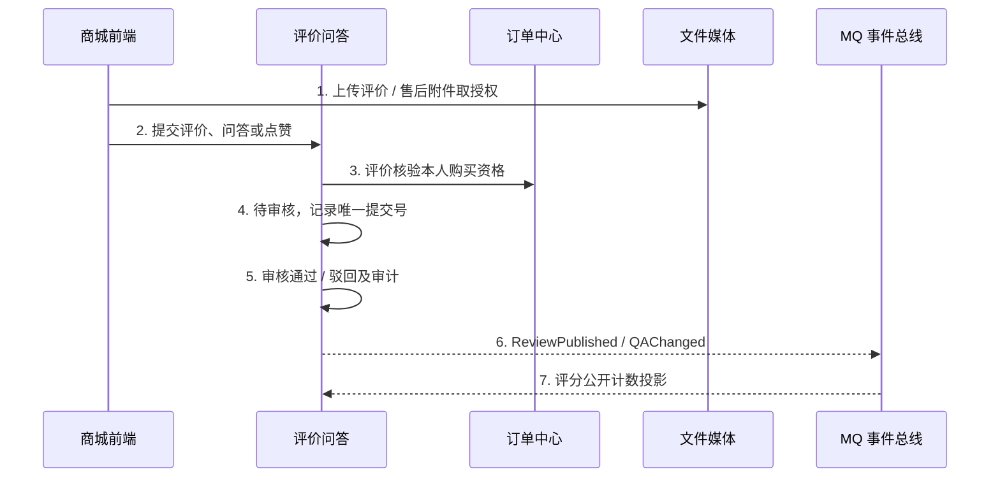

- 内容审核适配器归 interaction，图片扫描复用 media；问答与商家回答也需审核，未公开内容不进入公开计数。
- 点赞唯一键 review_id + user_id；评价唯一键按订单行 + 用户约束，追评单独记录。
- 收藏/对比/最近足迹由 engagement 管理。对比只用于浏览，进入结算一律 F03/F04 重报价；用户清理足迹不删除财务事实。

### F18 消息中心、客服工单与回复

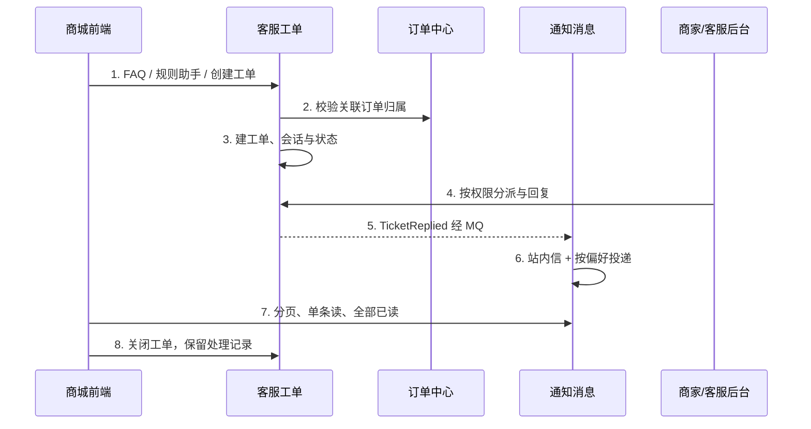

- notification 内部独立 inbox 与 delivery 模块：已读不等于短信送达；消息使用 event_id + recipient + template 唯一键。
- 购物帮助助手首期可用 FAQ/规则检索；接大模型时另加知识检索、敏感数据控制和人工转接，不让模型直接批准退款。
- 客服会话/附件保存于 helpdesk/media。业务通知由领域事件驱动，营销通知遵循用户订阅偏好。

### F19 购买后推荐、行为事件与索引更新

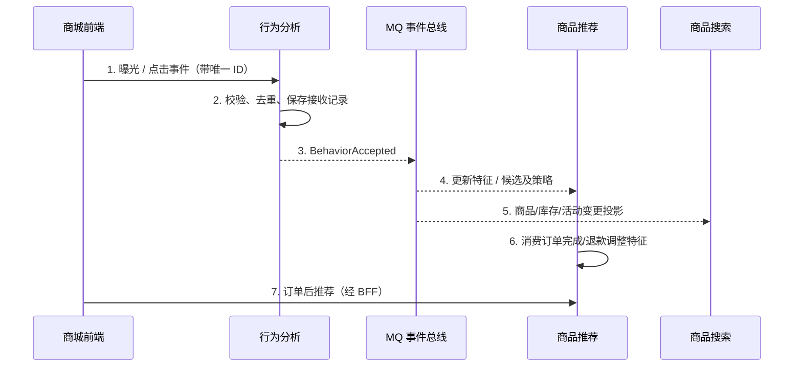

- 购买后推荐以服务端确认的订单商品为上下文，过滤下架、缺货和重复候选；不能信任前端传来的购买事实。
- 搜索历史/足迹有保留周期和清理接口；行为接入失败不阻塞浏览、结算或支付，推荐不可用时退回运营热销列表。
- 搜索/推荐读模型可重建。商品先写 catalog，再发变更事件更新索引；禁止同步双写数据库与搜索索引假设都成功。

## 5. 状态机与跨流程裁决

订单状态建议：

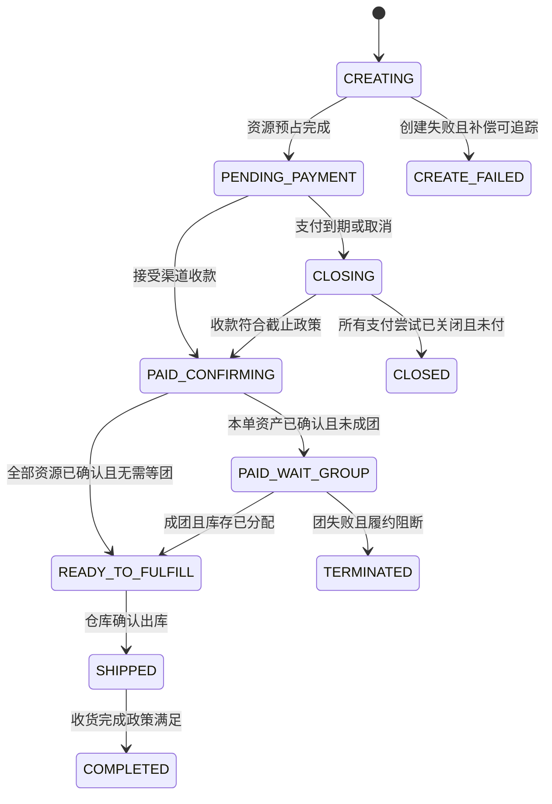

图中 `TERMINATED` 代表该订单交易不再履约，已收款部分继续由退款状态机追踪。普通订单退款、部分退款与售后不应全部覆盖掉主订单履约状态。退款/售后状态作为独立维度展示：

| 维度 | 典型状态 | 权威服务 |
| --- | --- | --- |
| 支付 | CREATED / PAYING / SUCCEEDED / CLOSED / RECONCILING | payment |
| 退款 | CREATED / PROCESSING / SUCCEEDED / FAILED / UNKNOWN | refund |
| 履约 | NEW / ALLOCATING / READY / CANCEL_REQUESTED / CANCEL_CONFIRMED / DISPATCHED | fulfillment |
| 售后 | REQUESTED / APPROVED / RETURNING / INSPECTED / REFUNDING / EXCHANGING / COMPLETED / REJECTED / CANCELLED | aftersale |
| 发票 | REQUESTED / PROCESSING / ISSUED / REVERSING / ADJUSTED / FAILED | invoice |

`PaymentSucceeded` 只说明真实收款；`OrderPaymentAccepted` 表示订单接受这次收款；`OrderReadyToFulfill` 表示所有发货前置条件满足。三者禁止混用。

拼团放行需要：团最终已成 + 本单券积分/活动额度提交完成 + 本单库存分配完成 + 未被终止。订单记录这几个事实后再 CAS 放行，不能依赖事件到达顺序。

## 6. 领域事件与消费者

| 事件 | 发布者 | 消费者 | 业务意义 |
| --- | --- | --- | --- |
| ProductChanged | catalog | search / recommendation / engagement | 规格、价格版本与上下架投影 |
| StockAvailabilityChanged | inventory | search / recommendation | 展示余量；不替代结算预占 |
| OrderAwaitingPayment | order | 持久化任务 / notification | 到期关单与待付款提醒 |
| PaymentSucceeded | payment | order / reconciliation | 只表示收款事实；订单独立裁决 |
| OrderPaymentAccepted | order | checkout / group | 提交资源或确认拼团付款席位 |
| OrderReadyToFulfill | order | fulfillment / notification | 唯一发货放行事件 |
| OrderClosed | order | checkout / notification | 逆向释放未消费资源 |
| GroupFormed / GroupFailed | group | checkout / order / notification | 放行或终止；失败成员退款 |
| ShipmentDispatched / Delivered | fulfillment / logistics | order / notification | 发货、轨迹、签收投影 |
| OrderCompleted | order | points / member / interaction / analytics | 奖励、成长、评价资格和特征 |
| ReturnInspectionCompleted | fulfillment | inventory / aftersale | 按质检分类入库；不等于退款成功 |
| RefundSucceeded | refund | order / aftersale / coupon / points / invoice / notification / reconciliation | 资金已退；各下游幂等补偿 |
| InvoiceIssued / InvoiceAdjusted | invoice | notification / reconciliation | 票据结果通知和对账 |
| ReviewPublished / QAChanged | interaction | search / catalog 读投影 | 公开评分、问答计数 |
| TicketReplied | helpdesk | notification | 工单回复通知 |

事件消费路由约束：

- 履约只接受订单的放行命令/事件，不能看到渠道收款就发货。
- 退款中心只执行经过业务授权的退款请求；售后通过规则裁决资格，订单处理关单后迟到付款/拼团失败/重复付款等系统退款。
- `RefundSucceeded` 驱动资金、券积分及票据后续；库存恢复由仓库退回验收或取消履约确认驱动。
- 对账服务不能直接改 payment/refund/order 的表；它提交修复命令给数据所有者，再由所有者产生事件。
- 库存、积分、券、退款、消息各自保留业务幂等记录，死信重放不产生第二次业务效果。

## 7. 一致性、失败补偿与接口契约

| 约束 | 实现要求 |
| --- | --- |
| 业务幂等 | 订单 user_id+idempotency_key；预占批次 order_id+resource_type，行级 reservation_id+sku_id+warehouse_id；支付商户单号；固定 refund_id；consumer+event_id。 |
| 事件格式 | event_id、event_type、aggregate_id、aggregate_version、schema_version、occurred_at、trace_id、correlation_id、causation_id；含必要业务 ID，不广播完整地址/手机号。 |
| 写入与投递 | 业务状态 + Outbox 同一数据库事务提交；Publisher Confirm 后标记发送，超时允许重发。消费者本地业务写入 + Inbox 去重同事务，成功后 ACK。 |
| 状态和乱序 | 订单/支付/退款/履约/售后/票据分别建状态机；CAS 带 version 和允许前态。按聚合版本去旧、发现缺口回查权威服务；不可依赖全局消息有序。 |
| 补偿与任务 | Saga 步骤含 UNKNOWN，固定凭据回查/Cancel；资源方保留取消墓碑防空回滚与悬挂。保存 due_at、attempt、last_error；退避重试、死信和人工补偿。 |
| 库存账 | 可承诺量 = 在库可售 - 预占 - 已分配；预占转分配不改变实物量。实际出库再减少在库与分配；退回验收按质检分类入账。 |
| 资金与资产 | 退款成功和处理中额度合计不得超原收款；订单行累计实退与售后数量受约束。券积分只基于原核销/抵扣记录，赠送积分不足冲回记待抵扣账。 |
| 读取与降级 | 关键写入/支付读权威库；搜索、推荐、消息计数最终一致。推荐/消息失败可降级，计价/库存/支付失败则阻断对应交易步骤。 |
| 外部回调 | 渠道身份、签名、商户、币种、金额、关联单号与重放校验；原请求号主动查单。外部受理成功不等于最终成功，渠道状态未知保留独立状态。 |
| 接口和鉴权 | 公网 HTTPS JSON /v1；BFF 只聚合不写库。内网同步可用 gRPC；mTLS/服务身份控制调用权限。服务从主体解析用户，跨对象读写校验归属。 |
| 审计与可观测 | 统一 trace_id 贯穿 HTTP、RPC、MQ、Saga 和渠道请求；审批、退款、发票、改价、改库存记操作者、原因、前后状态与业务单号。 |

### 预占/确认/取消接口

每类资源提供同义契约，由资源服务自己实现本地事务；编排是应用级 Saga / Try-Confirm-Cancel 风格，不假设使用某个分布式事务框架。

```text
Reserve(reservation_id, order_id, lines, expires_at, policy_version)
QueryReservation(reservation_id)
Confirm(reservation_id, order_id, order_version)
Cancel(reservation_id, order_id, reason, fencing_version)
```

- Reserve 重复请求返回原结果；资源预占与业务唯一键同事务。
- Confirm 仅可从允许前态执行；Cancel 和 Confirm 冲突时由资源状态与订单版本裁决，不能仅靠调用顺序。
- 若 Cancel 先于迟到的 Reserve 到达，资源保存取消墓碑，禁止之后的 Reserve 再占资源。
- 超时意味着未知，编排不得把它当成“肯定没有预占”。回查或使用同一个凭据幂等 Cancel。
- expires_at 用来触发检查，不独立授权释放。若订单在付款裁决或已接纳付款中，必须核对最终状态；补偿任务恢复后继续处理。

### 启发式失败不冒充原子回滚

渠道已经确认退款，积分返还失败时，资金状态仍为成功，资产补偿状态为待处理。开票平台失败不回滚已退款事实；外部仓库尚未确认拦截，不释放已分配库存。后台提供每步状态与人工重试，避免个人中心显示一个“完成”掩盖未完成的子任务。

## 8. 前端页面到 API 的映射

| 场景 | 公网 API 示例 | 业务归属 |
| --- | --- | --- |
| 认证 | POST /v1/auth/login  /  /refresh  /  /logout  /  /logout-all | iam |
| 商品搜索 | GET /v1/products  /  /products/{id}  /  /search/suggestions | search + catalog / BFF 聚合 |
| 对比收藏 | GET/PUT /v1/me/compare  /  PUT/DELETE /v1/me/favorites/{sku} | engagement |
| 结算报价 | POST /v1/checkouts  /  PATCH /v1/checkouts/{id}  /  /quote | checkout → pricing |
| 提交订单 | POST /v1/orders (Idempotency-Key, quote_id) | checkout 编排 → order |
| 支付 | POST /v1/orders/{id}/payments  /  GET /v1/payments/{id} | payment |
| 活动 | POST /v1/flash/{id}/requests  /  GET /v1/flash/requests/{id} | flash |
| 拼团 | POST /v1/groups  /  POST /v1/groups/{id}/join | group → checkout |
| 售后退款 | POST /v1/orders/{id}/aftersales  /  GET /v1/aftersales/{id} | aftersale；退款写接口仅内网 |
| 发票客服 | POST /v1/invoices  /  /v1/tickets；GET /v1/me/messages | invoice / helpdesk / notification |

接口约定：`Idempotency-Key` 用于具有副作用的创建请求；响应体返回业务单号、状态、版本和服务端时间，链路编号仅通过 `x-trace-id` 响应头提供。异步受理返回 `202 + request_id`，客户端查询原请求结果。资源不足返回可解释业务码；不能将所有失败压成 HTTP 500。

后台改价/上下架 → catalog；库存调整 → inventory；活动配置 → campaign/group/flash；售后审核 → aftersale；工单回复 → helpdesk；开票调整 → invoice。Admin BFF 统一页面接入，IAM 校验角色与数据范围，领域服务仍要校验业务权限及操作前态。

## 9. 技术栈与物理部署

| 层 | 参考选择 | 适用边界 |
| --- | --- | --- |
| 服务实现 | Go；外部 HTTPS JSON，内部 HTTP 或 gRPC | 不绑定具体 Web 框架；契约版本和超时预算先确定 |
| 权威事务数据 | MySQL / InnoDB，服务自有 schema 与账户 | 库存、券、积分、订单、支付使用本地事务/条件更新 |
| 缓存与准入 | Redis | 会话缓存、热点、限流、秒杀准入；不作为资金/库存唯一账本 |
| 业务事件 | RabbitMQ 持久化队列 + Confirm + 手动 ACK | 搭配 Outbox、Inbox、重试/死信；已有合适 MQ 时优先复用 |
| 搜索 | Elasticsearch 读索引 | 由事件重建；交易权威复核不依赖索引实时性 |
| 文件 | MinIO 或兼容对象存储 | 商品公开图可走 CDN；发票、售后与客服附件需鉴权 |
| 运维 | 容器化 + Jenkins；现有平台决定是否使用 Kubernetes | 按流量/故障域扩容，不将容器数等同于服务边界 |
| 观测与任务 | 统一追踪、结构化日志、指标告警、持久化 due_at 任务 | 关注积压、未知资金、Saga 超时与账务差异 |

| 首期部署组 | 包含服务 | 隔离重点 |
| --- | --- | --- |
| 接入组 | API Gateway + Shop BFF + Admin BFF | 认证、限流、路由；BFF 只做页面聚合 |
| 账号组 | iam / member / address | 会话边界清晰，可先同一进程多模块 |
| 商品内容组 | catalog / media / interaction / engagement / content | 商品读写与媒体上传分开扩容 |
| 发现组 | search / recommendation / analytics | 索引/特征可重建，独立消费线程池 |
| 交易组 | cart / pricing / checkout / order | checkout Saga 与 order 状态边界始终保留 |
| 营销组 | campaign / coupon / points | 各自账本及事务，不互相直接写表 |
| 高峰活动组 | flash / group | 独立限流、队列和资源隔离 |
| 履约售后组 | inventory / fulfillment / logistics / aftersale | 库存单独连接池与隔离资源 |
| 资金组 | payment / refund / reconciliation | 支付回调、退款、对账独立工作队列 |
| 票据组 | invoice | 外部票据平台波动不能阻塞资金退款 |
| 服务组 | notification / helpdesk | 站内消息、外部通知和客服独立队列 |

首期可共用高可用 MySQL、Redis、MQ 集群，不能共享业务表的写入权。交易、资金、库存和活动队列分开，线程池/连接池/限流独立；流量增长后优先将 inventory、flash、payment、search 单独扩容。编排、Outbox 投递和定时任务可作为所属服务的 worker 角色部署。

分布式任务的调度锁只减少重复执行，业务幂等才防止重复扣减；Redis 丢失/故障时，订单与资源账可从持久化数据核对恢复。服务副本数、主从拓扑、备份/RPO/RTO 和峰值容量需在真实规模确认后压测定稿。

## 10. 开发顺序与验收

| 阶段 | 交付范围 | 通过条件 |
| --- | --- | --- |
| 第一阶段：基础与普通交易 | IAM、会员地址、商品、库存、购物车、计价、结算、订单、支付、消息骨架 | 普通订单从报价到出库闭环；重复和异常收款可收敛 |
| 第二阶段：营销与会员资产 | 券积分、规则配额、满额加价购、拼团、秒杀 | 预占/核销/补偿一致，活动高峰隔离 |
| 第三阶段：逆向与运营 | 售后退款、换货、票据、对账、后台审批审计 | 部分退款、退货质检、票据调整、死信处置闭环 |
| 第四阶段：体验与优化 | 搜索、推荐、评价问答、客服、精细化分析 | 允许降级的读链路完善，索引与推荐可重建 |

1. 重复点击、HTTP 超时重试、队列重复投递：只能生成一笔有效订单、一份资源扣减和一笔目标退款。
2. 超卖测试覆盖同 SKU 多规格、普通池/活动池、换购 SKU、并发订单与释放补偿；库存账与实际出库账可核对。
3. 支付回调与关单竞争、回调丢失、渠道成功但本地超时、重复收款：最终收款/订单/退款都可收敛。
4. 拼团最后一人付款与到期任务并发；秒杀排队成功但库存不足；均必须有明确结果与资源归还。
5. 部分退款、券过期、积分奖励已花、换购门槛失效、已开票后退款：按原规则快照处理且不超退。
6. 未发货拦截失败转已发货路径；退回残次商品不增加可售库存；换货缺货不标记已完成。
7. 跨账号访问订单/地址/发票被拒；退出会话在约定窗口内失效；游客合并不导入任何金融或交易资产。
8. MQ/Redis/开票渠道不可用、服务进程重启、死信重放：Saga 与资金流水可恢复，报警和人工处置入口可定位。

## 11. 需业务确认的政策（不影响本次架构边界）

1. 订单支付期限、渠道迟到付款的接纳截止、拼团截止精度和人数规则。
2. 运费/包邮口径、活动叠加、换购门槛、换购项退货政策及退款差额分摊。
3. 券全退/部分退/过期返还政策，积分赠送入账时点与不足冲回处理。
4. 多仓分配、拆包发货、取消拦截时限、退货质检标准及换货补差能力。
5. 支付、物流、短信和开票渠道；正式票据开具/调整规则由财务及选定渠道确认。
6. 真实并发、SKU 和订单规模、数据保留、RPO/RTO、现有容器/MQ/数据库基础设施。

这些口径需要在后续接口与表结构设计前固化成版本化业务政策，禁止分散硬编码在前端或不同服务中。

## 12. 机制核对参考

- [RabbitMQ Reliability Guide](https://www.rabbitmq.com/docs/reliability)：连接失败可能导致重复投递，消费需要幂等。
- [RabbitMQ Consumer Acknowledgements and Publisher Confirms](https://www.rabbitmq.com/docs/confirms)：生产端确认与消费端确认是两个独立机制。
- [Redis Distributed Locks](https://redis.io/docs/latest/develop/clients/patterns/distributed-locks/)：复制与锁故障边界；不能把 Redis 锁视为库存/资金唯一正确性保障。
- [MySQL InnoDB Locking Reads](https://dev.mysql.com/doc/refman/8.4/en/innodb-locking-reads.html)：行级条件写入、锁定读取用于各服务本地事务仲裁。

上述官方文档用于核对消息确认、重复投递、Redis 故障边界和数据库本地并发控制；服务拆分与调用流程属于针对本商城的设计建议。
